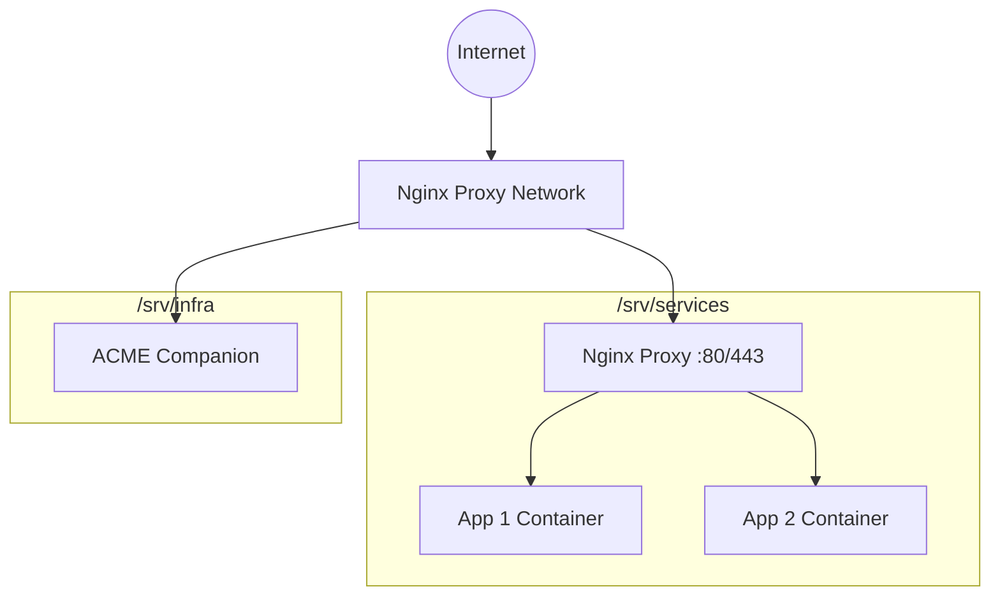

# CSky Infrastructure Wiki

> The single source of truth for CSky's production infrastructure.

## Repository Overview
This repository contains the configuration, orchestration, and documentation for the entire CSky infrastructure platform. It governs how the VPS is provisioned, how the proxy routes traffic, and strictly defines the standards every application must follow.

## Architecture Overview


## Folder Structure
```text
/
├── proxy/          # Core reverse proxy (nginx-proxy + acme-companion)
├── scripts/        # Utility and backup scripts
├── docs/           # Internal Engineering Wiki
└── ...
```

## Quick Start
1. **New to the project?** Start with [Getting Started](docs/GETTING_STARTED.md).
2. **Setting up a new server?** See [VPS Setup](docs/VPS_SETUP.md).
3. **Deploying a new service?** Read the [Service Standard](docs/SERVICE_STANDARD.md) and [Deployment Guide](docs/DEPLOYMENT.md).

## Documentation Index

### Core Architecture
- [Architecture & History](docs/ARCHITECTURE.md)
- [Reverse Proxy](docs/REVERSE_PROXY.md)
- [Service Standard](docs/SERVICE_STANDARD.md)
- [Filesystem Permissions](docs/PERMISSIONS.md)

### Operations
- [Deployment Workflow](docs/DEPLOYMENT.md)
- [CI/CD Standard](docs/CI_CD.md)
- [Daily Operations](docs/OPERATIONS.md)
- [Migration Guide](docs/MIGRATION.md)

### Support
- [Troubleshooting](docs/TROUBLESHOOTING.md)
- [Disaster Recovery](docs/DISASTER_RECOVERY.md)
- [Changelog & Commits](docs/CHANGELOG_GUIDE.md)
