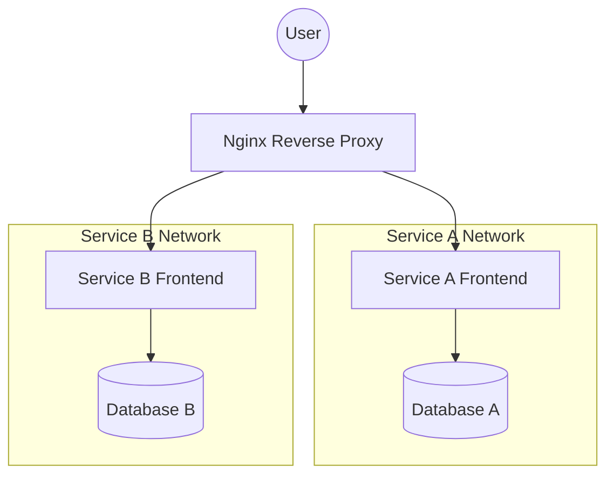

# Architecture & Platform History

## Why does this exist?
To document the fundamental design philosophy of the CSky platform and preserve the history of major architectural decisions.

## When should it be used?
When proposing systemic changes, onboarding engineers, or resolving disputes about "the right way" to build a service.

## Platform History & Major Decisions

### 1. Separation of Infra and Services
- **Decision**: The `infra` repository manages the proxy and server-level scripts, while each application has its own isolated repository deployed in `/srv/services`.
- **Why**: Blast radius. An error in an application deployment should never take down the reverse proxy or affect the deployment of other services.

### 2. Standardization on `/srv`
- **Decision**: All configurations go to `/srv/infra` and apps to `/srv/services`.
- **Why**: FHS (Filesystem Hierarchy Standard) compliance. `/srv` is specifically intended for site-specific data served by the system, keeping our Docker data cleanly separated from OS binaries (`/opt`) and user data (`/home`).

### 3. External Proxy Network
- **Decision**: We use an external Docker network named `proxy`.
- **Why**: Security and isolation. Instead of dumping everything on the default bridge, the `proxy` network securely bridges the edge router to frontend containers, while databases stay on isolated internal compose networks.

### 4. CI/CD via GitHub Actions and GHCR
- **Decision**: Images are built via GitHub Actions and stored in GHCR (GitHub Container Registry).
- **Why**: Simplifies secret management and natively integrates with our source code. It prevents the VPS from wasting CPU cycles building images locally.

### 5. Deployment User Standard
- **Decision**: 
  - Services run as the host deployment user (`csky`).
  - Containers must consume `PUID` and `PGID` supplied by the infrastructure.
  - Numeric UIDs must never be assumed.
  - UID `1000` must never be hardcoded.
  - Files under `/srv` must always be owned by `csky:csky`.
  - Service repositories must inherit these standards from the Infrastructure Repository instead of redefining them.
- **Reasoning**: This eliminates bind-mount permission conflicts without resorting to insecure `chmod 777` or complex entrypoint `chown` scripts. By dropping default values, we enforce a "fail fast" methodology: if PUID/PGID are missing from the `.env`, the deployment fails immediately rather than silently running under the wrong ID. The infrastructure must NEVER hardcode numeric UIDs. Numeric UIDs vary across cloud images (e.g., 1000 might be `ubuntu` on one system and `csky` on another); forcing an explicit environment variable ensures total portability across heterogeneous VPS environments.

### 6. Services Own Their `infra` Folder
- **Decision**: Every service repository contains an `infra/` directory holding its `docker-compose.yml` and `data/`.
- **Why**: Unifies the infrastructure-as-code pattern at the service level. An engineer can look at any repository and immediately know where the deployment configuration lives.

## Architecture Diagram

## Common Mistakes
- **Blurring the lines**: Trying to deploy an application's database inside the `infra` repository instead of the service's own `infra/` folder.

## Troubleshooting
- See [TROUBLESHOOTING.md](TROUBLESHOOTING.md) for architectural failure modes.

## Related Documentation
- [Service Standard](SERVICE_STANDARD.md)
- [Permissions](PERMISSIONS.md)
