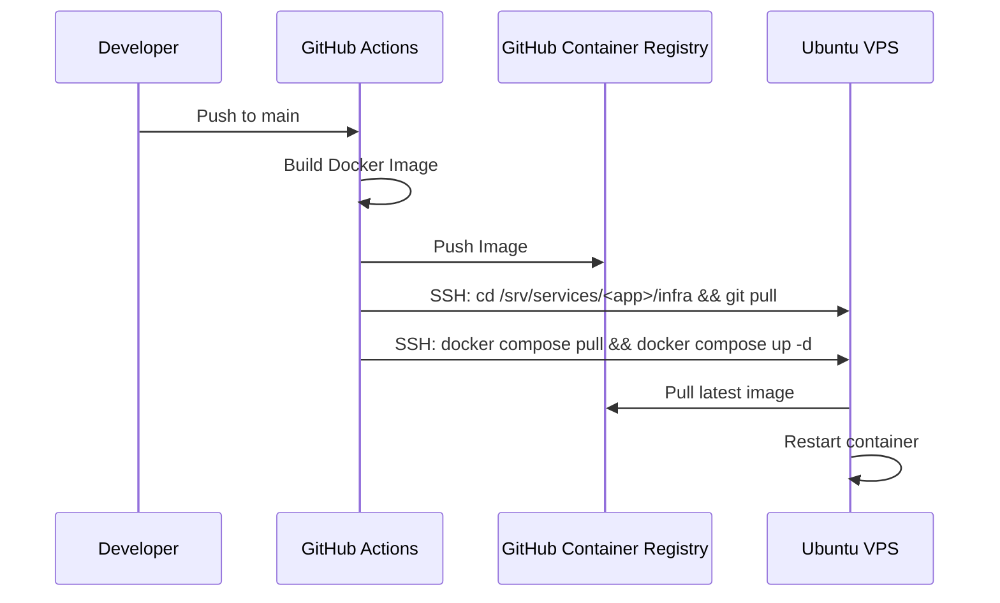

# CI/CD Pipeline Standard

## Why does this exist?
To ensure all CSky services are built and deployed using a uniform, automated process, minimizing human error.

## When should it be used?
When configuring GitHub Actions for a new service repository.

## How does it work?
We use GitHub Actions to build Docker images and push them to GHCR. The deployment to the VPS is executed via SSH.

### Sequence Diagram

## Step-by-Step Instructions

1. **GitHub Secrets**: Add `VPS_SSH_KEY`, `VPS_HOST`, and `VPS_USER` to your repository secrets.
2. **GHCR Authentication**: Ensure the VPS `deploy` user is authenticated to GHCR using a Personal Access Token (PAT).
3. **Action Workflow**: Place the standard workflow in `.github/workflows/deploy.yml`.

## Common Mistakes
- **Image Tags**: Do not hardcode `latest` in the workflow without ensuring proper rolling updates. Use SHA-based tags for safety.
- **SSH Key**: Using a key with a passphrase. CI/CD SSH keys must be passwordless.

## Troubleshooting
- **GHCR Pull Fails on VPS**: The VPS `deploy` user's PAT may have expired. Regenerate it and `docker login ghcr.io`.

## Related Documentation
- [Deployment Workflow](DEPLOYMENT.md)
